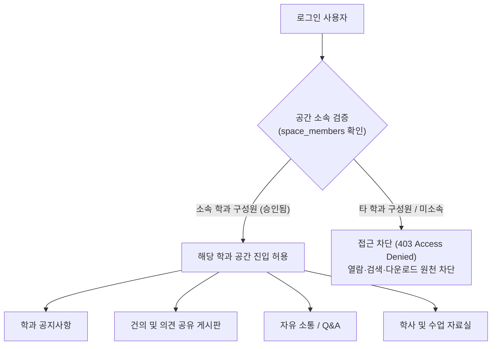
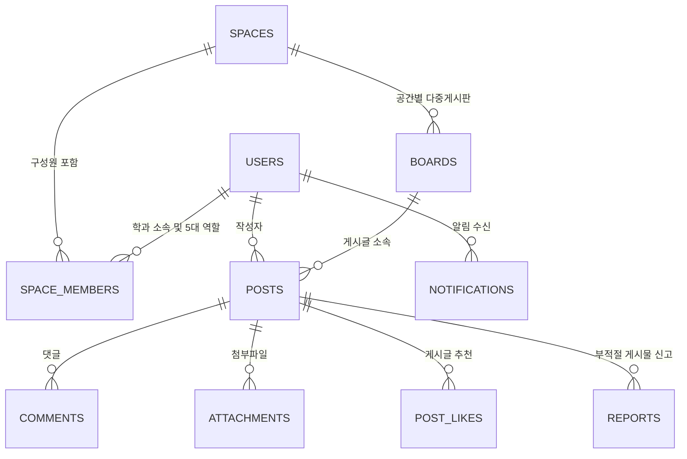

# 학과별 복합 다중게시판 시스템 설계서 (System Design Document)

## 1. 시스템 개요 및 목적
본 시스템은 대학 내 **학과 구성원들이 공지사항과 다양한 의견을 안전하고 체계적으로 공유**할 수 있도록 설계된 **멀티 공간(학과) 기반 복합 다중게시판 시스템**입니다.

### 1.1 다중게시판과 복합다중게시판의 개념 적용
* **다중게시판 (Multi-board):** 하나의 시스템 안에서 공지사항, 건의/의견 게시판, 자유/Q&A 게시판, 자료실 등 목적과 성격이 다른 여러 개의 게시판을 동적으로 생성·운영하는 구조입니다.
* **복합다중게시판 (Composite Multi-board):** 단순 게시판 나열을 넘어, **상위 운영 공간(학과) 분리**, **5단계 세분화된 역할 권한 제어**, **게시판별 맞춤 속성(공지 전용, 익명 허용, 추천/공감, 첨부파일, 카테고리)**, **신고·블라인드 등 문제 대응 워크플로우**가 복합적으로 결합된 구조입니다.

---

## 2. 공간(Space) 구조 및 접근 차단 아키텍처

### 2.1 3대 공간 운영 원칙
1. **공간별 여러 게시판 운영:**
   * 각 학과(`컴퓨터공학과`, `디자인학과`, `경영학과` 등)는 독립된 **운영 공간(Space)**을 가집니다.
   * 각 공간 내부에는 학과 특성과 목적에 맞는 여러 게시판(`학과 공지사항`, `건의 및 의견 게시판`, `자유 소통/Q&A`, `학사 자료실` 등)을 개설할 수 있습니다.
2. **공간별 게시판과 사용자 관리:**
   * 각 공간은 해당 공간의 관리자(`SPACE_ADMIN`)가 독립적으로 게시판을 추가·수정·삭제하고, 소속 구성원의 가입 승인 및 역할(5단계)을 관리합니다.
3. **공간 간 접근 차단 (Data & Access Isolation):**
   * 특정 학과 공간에 소속되지 않은 사용자는 타 학과 공간의 게시판 목록, 게시글 본문, 댓글, 첨부파일, 검색 결과에 **절대 접근할 수 없습니다(403 Forbidden 차단)**.

---

## 3. 사용자 유형 (5대 역할) 및 권한 설계

게시판을 사용하는 구성원은 역할에 따라 다음 **5가지 유형**으로 구분되며, 각 공간별로 역할이 부여됩니다.

| 구분 | 역할 코드 | 역할 명칭 | 학과 구성원 예시 | 가입 인증 코드 (예시) | 상세 권한 설명 |
| :---: | :--- | :--- | :--- | :--- | :--- |
| **①** | `READER` | **게시글을 읽는 사람** | 신입생(준회원), 열람 전용 구성원 | 코드 불필요 | 공간 내 게시글 및 댓글 조회, 검색, 첨부파일 다운로드만 가능 (글/댓글 작성 불가) |
| **②** | `WRITER` | **게시글·댓글을 작성하는 사람** | 일반 학과 재학생 | 코드 불필요 | 게시글 조회 + 일반 게시글 및 댓글 작성, 본인 글/댓글 수정·삭제, 게시글 추천 및 신고 |
| **③** | `NOTICE_MANAGER` | **공지사항을 등록하는 사람** | 교수진, 학과장 | `CSE-PROF` / `PROF-2026` | 일반 작성 권한 + 공지 전용 게시판 글 작성 및 상단 고정 공지사항 등록/해제 |
| **④** | `MODERATOR` | **부적절한 게시물을 관리하는 사람** | 모더레이터, 학생회 임원 | `CSE-MOD` / `MOD-2026` | 일반 작성 권한 + 타인의 부적절한 게시글·댓글 숨김(블라인드) 및 강제 삭제, 신고 내역 처리 |
| **⑤** | `SPACE_ADMIN` | **게시판·운영공간을 관리하는 사람** | **과별 학과 조교** (컴공 조교, 디자인과 조교, 경영과 조교) | `CSE-ADMIN`, `DSN-ADMIN`, `BIZ-ADMIN` / `ADMIN-2026` | **오직 자기 소속 학과에서만** 게시판 생성·수정·삭제, 구성원 승인/강퇴 및 역할 부여 권한 보유 (타 학과 권한 없음) |

### 3.0 학과별 조교 분리 및 직책 코드 회원가입 정책
* **과마다 전담 조교 배치:** 컴퓨터공학과(`박조교`), 디자인학과(`한조교`), 경영학과(`오조교`) 등 모든 학과 공간마다 전담 조교(`SPACE_ADMIN`)가 존재하며, 새 학과 개설 시에도 해당 학과 전담 조교가 자동 배정됩니다.
* **조교의 자기 학과 권한 격리:** 각 학과 조교는 `space_members` 테이블을 통해 **오직 자기 소속 학과(`spaceId`)에 대해서만 `SPACE_ADMIN` 권한**을 가지며, 타 학과 공간에 대해서는 열람 및 관리 권한이 철저히 차단(`403 Access Denied`)됩니다.
* **직책 인증 코드 회원가입:** 회원가입 시 소속 학과를 선택하고 특정 직책 코드(`CSE-ADMIN`, `CSE-MOD`, `CSE-PROF` 또는 `ADMIN-2026`, `MOD-2026`, `PROF-2026`)를 입력하면 선택한 학과의 **조교(`SPACE_ADMIN`), 모더레이터(`MODERATOR`), 교수(`NOTICE_MANAGER`)**로 즉시 가입할 수 있습니다.

### 3.1 역할별 기능 권한 매트릭스

| 기능 항목 | ① 읽는 사람 (`READER`) | ② 작성하는 사람 (`WRITER`) | ③ 공지 등록자 (`NOTICE_MANAGER`) | ④ 게시물 관리자 (`MODERATOR`) | ⑤ 공간/게시판 관리자 (`SPACE_ADMIN`) |
| :--- | :---: | :---: | :---: | :---: | :---: |
| 공간 내 게시글·댓글 조회 및 검색 | O | O | O | O | O |
| 첨부파일 다운로드 | O | O | O | O | O |
| 일반 게시글 및 댓글 작성 | X | O | O | O | O |
| 본인 게시글·댓글 수정 및 삭제 | X | O | O | O | O |
| 게시글 추천(공감) 및 부적절 게시물 신고 | X | O | O | O | O |
| **공지사항 등록 및 상단 고정** | X | X | **O** | X | **O** |
| **부적절한 게시글·댓글 블라인드/강제 삭제** | X | X | X | **O** | **O** |
| **게시글 타 게시판으로 이동** | X | X | X | **O** | **O** |
| **문제 사용자 작성 제한(읽기 전용 강등)** | X | X | X | **O** | **O** |
| **게시판 생성·수정·삭제 및 공간 사용자 관리** | X | X | X | X | **O** |

---

## 4. 일반 사용자 및 관리자 핵심 요구사항 매핑

### 4.1 일반 사용자 요구사항
1. **필요한 게시글을 쉽게 찾고 읽을 수 있어야 한다.**
   * **공간 내 통합 검색 및 게시판별 검색:** `제목+내용`, `제목`, `내용`, `작성자`, `카테고리(말머리)` 조건 검색 지원
   * **다양한 정렬:** `최신순`, `추천순(공감 많은 의견)`, `조회순` 정렬 지원
   * **공지 상단 고정:** 중요 학과 공지사항을 게시판 최상단에 고정 배치하여 즉시 확인 가능
2. **자신의 게시글과 댓글을 관리할 수 있어야 한다.**
   * **내 활동 모아보기 (`내 글·댓글 관리`):** 본인이 작성한 모든 게시글과 댓글을 한 화면에서 모아보고, 즉시 수정하거나 삭제 가능
   * **본인 작성물 수정·삭제:** 게시글 상세 화면 및 댓글 목록에서 본인 작성물에 대해 직접 수정(수정일시 자동 갱신) 및 삭제 가능

### 4.2 관리자 요구사항
1. **게시판이 목적에 맞게 운영되도록 관리할 수 있어야 한다.**
   * **게시판 맞춤 설정:** 게시판별 명칭, 설명, 말머리(카테고리), 쓰기 허용 권한(누구나 vs 공지담당자 전용), 익명 허용 여부를 설정
   * **게시글 이동 기능:** 게시판 성격에 맞지 않는 게시글(예: 공지 게시판이나 건의 게시판에 잘못 올라온 글)을 알맞은 게시판으로 즉시 이동
2. **문제가 발생했을 때 대응할 수 있어야 한다.**
   * **신고 접수 및 부적절 게시물 조치:** 욕설·비방·도배 게시물 및 댓글을 즉시 **블라인드(숨김) 처리**하거나 **강제 삭제**
   * **문제 사용자 제재:** 규정 위반 사용자를 **`읽기 전용(READER)`으로 강등**시켜 글/댓글 작성을 차단하거나 공간에서 **강제 퇴출(접근 차단)**

---

## 5. 8대 핵심 기능 및 게시글 데이터 명세

### 5.1 8대 핵심 기능 명세
1. **회원가입과 로그인:** 아이디/비밀번호/이름/희망 소속 학과를 입력하여 가입하고 로그인인증 수행
2. **게시글 조회:** 게시판별 목록 조회, 상단 고정 공지 조회, 상세 본문 열람, 조회수 자동 증가
3. **게시글 작성:** 제목, 카테고리, 내용, 첨부파일, 공지 여부(권한자), 익명 여부(허용 게시판) 입력 및 수정·삭제
4. **댓글:** 게시글 하단 의견 댓글 작성, 본인 댓글 수정·삭제, 관리자의 부적절 댓글 블라인드·삭제
5. **파일첨부:** 게시글 작성/수정 시 다중 파일 업로드, 파일명·용량 표시 및 소속 학과 구성원 전용 다운로드
6. **검색:** 소속 학과 공간 내 전체 또는 개별 게시판 대상 키워드 및 카테고리 검색
7. **알림:** 내 글에 댓글이 달렸을 때, 내 글이 추천받았을 때, 학과 새 공지가 등록되었을 때, 관리 조치가 발생했을 때 실시간 인앱 알림 제공
8. **게시글 추천:** 유용한 공지나 공감되는 학과 의견에 추천(좋아요) 클릭 및 추천순 인기글 정렬

### 5.2 게시글(Post) 필수 구성 정보
| 필드명 | 영문 컬럼명 | 입력 주체 | 설명 |
| :--- | :--- | :---: | :--- |
| **제목** | `title` | 사용자 입력 | 게시글의 제목 (필수) |
| **내용** | `content` | 사용자 입력 | 공지사항 또는 의견의 본문 내용 (필수) |
| **첨부파일** | `attachments` | 사용자 입력 | 업로드된 파일 목록 (`파일명`, `파일크기`, `MIME타입`, `데이터/경로`) |
| **작성자** | `authorId` / `authorName` | 시스템 자동 기록 | 작성한 구성원의 식별자 및 표시 이름 (익명 선택 시 '익명 학우' 표시) |
| **작성일시** | `createdAt` | 시스템 자동 기록 | 게시글 최초 등록 일시 (`YYYY-MM-DD HH:mm:ss`) |
| **수정일시** | `updatedAt` | 시스템 자동 갱신 | 게시글 최종 수정 일시 (수정 시 자동 업데이트 및 화면 표시) |

---

## 6. 데이터베이스 ERD 및 데이터 영속성 설계

### 6.1 ERD (Entity-Relationship Diagram)

### 6.2 데이터 영속성 (껐다 켜도 정보가 유지되는 구조)
* **브라우저 내장 영구 DB (`IndexedDB` + `LocalStorage`):**
  * 모든 게시글, 댓글, 회원, 공간/게시판 설정, 첨부파일 바이너리 데이터가 변경 즉시 브라우저의 비휘발성 디스크 저장소(`IndexedDB` 및 `LocalStorage`)에 저장됩니다.
  * 브라우저를 완전히 닫았다가 다시 열거나 PC를 재부팅해도 모든 정보와 첨부파일이 그대로 유지됩니다.
* **로컬 디스크 파일 동기화 (`start-server.ps1` → `data/db.json`):**
  * 로컬 서버 실행 시 모든 변경 사항이 프로젝트 폴더 내 `data/db.json` 파일에 물리적으로 기록되며, JSON 파일 내보내기(백업)/불러오기(복원) 기능을 함께 제공합니다.
